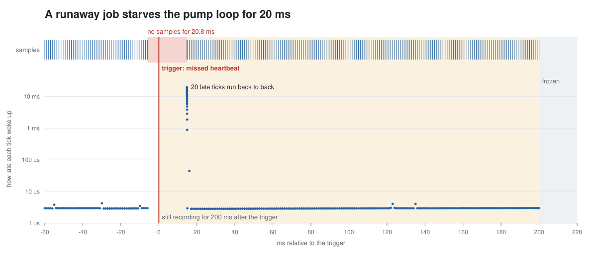
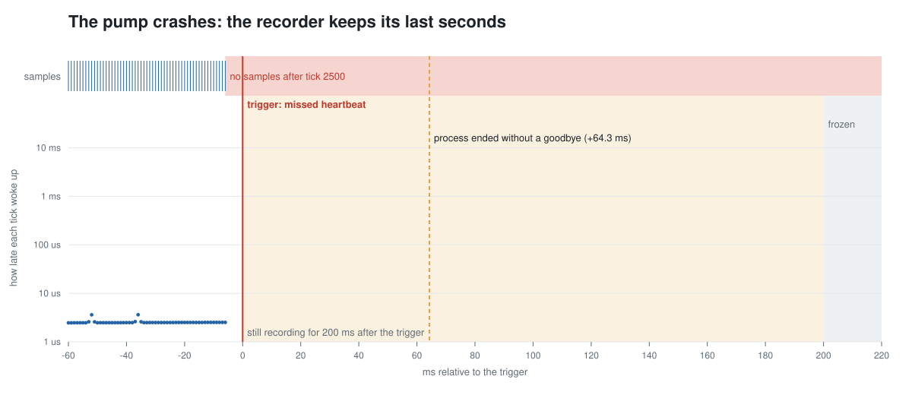

# Last Second

**A flight recorder for real-time loops on QNX OS 8.0.** When a control loop in a robot or a medical device misses its deadline or crashes, Last Second has already kept the seconds before it, frozen at the moment it went wrong, in a process the failure cannot take down.



## The problem

After an incident, the question is always what the loop was doing in its last seconds. Logging from the loop to a file is too slow for a 1 kHz loop and dies with its process. A flight recorder has to:

- take a sample from the loop in microseconds, without ever making the loop late;
- keep the last N seconds in RAM, outside the loop's process, and save them where a reboot cannot erase them;
- freeze by itself when the loop misses its heartbeat or its process dies, and still keep a little of what happened next;
- let only authorised processes write to it or read it.

## What it does

- **`blackboxd`** is a resource manager at `/dev/blackbox`. A producer opens it, declares a name and a heartbeat deadline once (`devctl`), then `write()`s one 32-byte sample per tick. The recorder stamps each sample with `ClockCycles()` and keeps the newest 30,000 (30 s at 1 kHz).
- **Triggers.** A watchdog timer pulse checks every producer's heartbeat each millisecond. A producer that closes without saying goodbye (the kernel closed it because its process died) is a trigger too. After a trigger, the recorder keeps recording for 200 ms, then freezes. Writes after that are counted and dropped, and the loop never sees an error.
- **Saved to disk.** With `-s dir`, each frozen window is also written as CSV by a low-priority thread, so a write to disk never delays a producer. The newest 20 are kept. The file is synced, renamed into place and the directory synced, so a power cut leaves a whole window or none.
- **`bbtool`** is the service tool. `status` shows the trigger and the culprit. `dump` writes the frozen window as CSV, with times relative to the trigger, plus a summary: the culprit's last sample and its longest gap. `trigger` and `reset` do what they say.
- **Demo programs.** `pump` is a 1 kHz infusion-pump flow loop: a PI controller on a simulated pump, one sample per tick (setpoint, flow, motor command, how late the tick woke up). `hog` is a runaway job.
- **A security policy** decides who may use the recorder. Only the pump's and the service tool's types may connect to it, and the kernel refuses everything else.

## Results on QNX OS 8.0 (QEMU x86_64, instruction counting, so times are emulated)

All of this runs at boot from `scenario/demo.sh`, on an image built with `--secpol=secure`:

| | What happened |
|---|---|
| Starvation | `hog` runs for 20 ms at priority 40, above the pump's 30. The recorder triggers **6.0 ms** after the pump's last sample (5 ms deadline plus the 1 ms watchdog period), while the hog still holds the CPU: its watchdog pulse is delivered at priority 60. The window shows a **20.8 ms** gap, then the 20 queued timer pulses run back to back. A control engineer may prefer to skip missed ticks rather than replay them. |
| Crash | `pump -c 2500` dereferences a null pointer at tick 2500. The heartbeat triggers 6.0 ms later, and the recorder then sees the process end without a goodbye **22.2 ms** after the trigger (10 to 64 ms across my runs). QNX's `dumper` also wrote `pump.core`. That tells a crash (or kill) apart from a hang. The frozen window holds the loop's last 2.5 s, and the core file holds the stack. |
| Cost to the loop | A `write()` of one sample to the recorder took **4.8 us** at p50 and p99 and **7.2 us** at most, over 4,107 ticks. |
| Survives a reboot | Both frozen windows were saved to `/data/var/blackbox` (142 KB and 110 KB of CSV). In a separate test I booted the image twice, with QEMU killed at the end of each run like a power cut. The second boot listed the first boot's windows. Before the directory sync was added, that test found a window left as `.part`. |
| Security | Under the policy, `bbtool` run as any other type gets `open /dev/blackbox: Operation not permitted`, and a shell gets `cannot create /dev/blackbox: Operation not permitted`. The recorder never sees the message. |



## How it uses QNX

- **A resource manager** (`iofunc`/`dispatch`, with an extended OCB per client) gives the recorder a POSIX interface: `open`, `write`, `read`, `devctl`. Any QNX program can use it; the header is the whole API.
- **Message passing and priority inheritance.** Each `write()` is a `MsgSend()`. The recorder's thread receives it at the writer's priority (QNX's message-driven priority inheritance), copies 32 bytes and replies. There are no locks or shared memory between the loop and the recorder.
- **Pulses and timers.** The pump's loop blocks in `MsgReceivePulse()` on a 1 ms timer pulse. The recorder's watchdog is a timer pulse to its own channel at priority 60, so it still runs while a runaway thread holds the CPU.
- **Microkernel isolation.** The samples live in the recorder's address space, so a crash in the loop cannot corrupt or lose them. The kernel closing a dead process's connection is the death signal. QNX's `dumper` adds the core file.
- **Priorities, all the way down.** The watchdog's pulse runs at 60, producers' writes run at their own priority, and the saver thread runs at 8, so saving to disk can only use time nobody else needs.
- **Security policies.** `SECPOL=open` builds an image where `secpolgenerate` records the rules the system needs while the demo runs, with every process started under its own type (`on -T`). [`policy/last-second.secpol`](policy/last-second.secpol) is that generated policy, reviewed:
  - `allow_attach blackbox_t { /dev/blackbox };`
  - `channel_connect:devb_t` for `blackbox_t`, to write the saved windows;
  - `channel_connect:blackbox_t` only for `pump_t` and `bbtool_t`;
  - nothing for the runaway `hog_t`;
  - the `intruder_t` rule that open mode recorded is removed.

  `SECPOL=secure` builds the enforcing image.

## Build and run

You need QNX SDP 8.0 on a Linux x86_64 host. On an Apple Silicon Mac, a Linux container with Rosetta works; the [Deadline CI codelab](https://github.com/vinit1009/deadline-ci/blob/main/docs/tutorial-trace-qnx-in-qemu.md) shows how. You also need QEMU on the host.

```bash
source ~/qnx800/qnxsdp-env.sh
target/build.sh ../last-second-image                                   # no policy
SECPOL=open target/build.sh ../last-second-image-open                  # record a policy
SECPOL=secure POLICY=$PWD/policy/last-second.secpol target/build.sh ../last-second-image-secure

target/run-qemu.sh ../last-second-image-secure runs                    # on the host: boots, runs the demo,
                                                                       # saves runs/serial.log and the CSVs
python3 host/plot.py runs/heartbeat.csv docs/heartbeat.svg --log runs/serial.log --scene heartbeat
make test                                                              # the recorder's logic, on the host
```

With `SECPOL=open`, the demo prints the generated policy between `===LS-POLICY-BEGIN===` markers on the console.

## Use it from your own loop

```c
#include "blackbox.h"

int fd = open(BB_PATH, O_WRONLY);
bb_hello_t hello = { .deadline_us = 5000, .name = "my-loop" };
devctl(fd, DCMD_BB_HELLO, &hello, sizeof hello, NULL);
for (;;) {
    /* ... wait for the tick, do the work ... */
    bb_sample_t s = { .seq = ++n, .v = { setpoint, measured, command, late_us } };
    write(fd, &s, sizeof s);
}
devctl(fd, DCMD_BB_GOODBYE, NULL, 0, NULL);   /* a clean stop is not a trigger */
```

## Layout

- `include/blackbox.h`: the interface (sample format, `devctl` commands, status).
- `src/core.c`: the recorder's logic, plain C (ring, producers, heartbeats, trigger -> freeze), tested on the host by `tests/test_core.c`.
- `src/blackboxd.c`: the resource manager.
- `src/pump.c`, `src/hog.c`, `src/bbtool.c`: the demo and the service tool.
- `scenario/demo.sh`, `image/local/snippets/`, `target/`: the boot-time demo, the image, building and QEMU.
- `policy/last-second.secpol`: the security policy. `host/plot.py` draws the charts.
- `examples/`: the console log and both frozen windows from the run on the secure image (what the charts and the numbers above come from).

## Limits

- Saved windows are plain CSV on the data partition. A real device would put them on dedicated storage and sign them, so they can be trusted as evidence.
- One recorder thread serves every producer. That is fine for a handful of 1 kHz loops; heavier use would want a pool or shared memory with a lock-free ring.
- The numbers above are emulated time under QEMU. Measure on your target before choosing deadlines.
- This is a demonstration, not a certified medical or safety component.

## License

MIT
